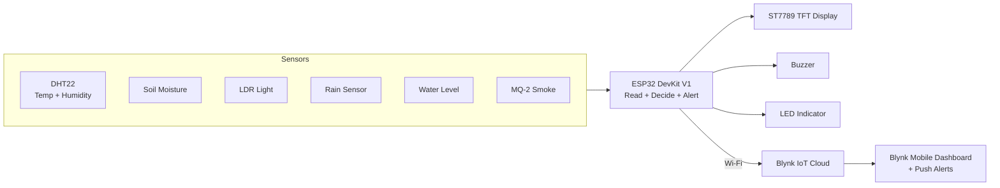

# AI-Enabled Plant Health Monitoring & Safety System

An ESP32-based smart agriculture system that continuously monitors plant and field
conditions — soil moisture, temperature, humidity, light, rainfall, water level and
smoke — shows the readings on an on-board TFT display, pushes them to a Blynk IoT
cloud dashboard, and raises local + remote alerts when anything goes out of range.


---

## Table of Contents

- [Overview](#overview)
- [Problem Statement](#problem-statement)
- [Key Features](#key-features)
- [System Architecture](#system-architecture)
- [Hardware Components](#hardware-components)
- [Pin Mapping](#pin-mapping)
- [How It Works](#how-it-works)
- [Alert Thresholds](#alert-thresholds)
- [Blynk Dashboard](#blynk-dashboard)
- [Getting Started](#getting-started)
- [Configuration & Secrets](#configuration--secrets)
- [Project Structure](#project-structure)
- [Demo](#demo)
- [Known Limitations & Future Scope](#known-limitations--future-scope)
- [Author](#author)
- [License](#license)

---

## Overview

Small and marginal farmers often have no easy way to know what is happening in their
field or with their stored produce until damage is already done — a crop dries out,
a tank runs empty, or smoke/fire starts in a storage area. This project is a
low-cost, connected monitoring node that watches the most important environmental
parameters and warns the user the moment something needs attention.

It combines an **ESP32** microcontroller, a set of low-cost sensors, a **local TFT
display** for on-site readouts, and the **Blynk IoT platform** for remote monitoring
and push alerts from anywhere.

## Problem Statement

- Crop health depends on soil moisture, temperature, humidity and light — all of
  which change constantly and are invisible to the naked eye.
- Water tanks run dry and rainwater events are missed, wasting water or drowning crops.
- Fire/smoke in farm storage is a serious safety hazard with no early warning.
- Manual inspection is time-consuming and does not scale beyond a small plot.

This system automates that monitoring and gives the user both an on-device display
and a phone dashboard with real-time alerts.

## Key Features

- **Multi-sensor monitoring** — soil moisture, temperature, humidity, light, rain,
  water level and smoke, all read continuously.
- **On-board TFT display** — live values and a colour-coded system status
  (SAFE / WARNING / DANGER) rendered on an ST7789 SPI display.
- **Cloud dashboard (Blynk)** — every reading is pushed to virtual pins and viewable
  on the Blynk mobile app in real time.
- **Smart alerting** — threshold-based push notifications via Blynk events, plus a
  **local buzzer** for smoke and an **LED** indicator for low light.
- **Debounced alerts** — each alert fires only once per event and resets
  automatically, avoiding notification spam.
- **Wi-Fi connected** — no extra gateway needed; the ESP32 talks to the cloud directly.

## System Architecture



## Hardware Components

| # | Component | Qty | Purpose |
|---|-----------|-----|---------|
| 1 | ESP32 DevKit V1 | 1 | Main controller with built-in Wi-Fi |
| 2 | DHT22 (AM2302) | 1 | Temperature & humidity sensing |
| 3 | Soil moisture sensor | 1 | Soil moisture / irrigation need |
| 4 | LDR (light) module | 1 | Ambient light level |
| 5 | Rain sensor module | 1 | Rainfall detection |
| 6 | Water level sensor | 1 | Tank / reservoir level |
| 7 | MQ-2 smoke & gas sensor | 1 | Smoke / fire safety |
| 8 | ST7789 TFT display (240x320, SPI) | 1 | On-device live readout |
| 9 | Active buzzer | 1 | Audible smoke alarm |
| 10 | LED | 1 | Low-light indicator |
| 11 | Breadboard + jumper wires | — | Prototyping connections |
| 12 | 5V supply / USB | 1 | Power |

## Pin Mapping

| Function | ESP32 GPIO | Notes |
|----------|-----------|-------|
| TFT CS | 5 | ST7789 chip select |
| TFT DC | 2 | Data / command |
| TFT RST | 15 | Reset |
| DHT22 data | 4 | Temp + humidity |
| Soil moisture | 34 | ADC input |
| LDR / light | 35 | ADC input |
| Rain sensor | 32 | ADC input |
| Water level | 33 | ADC input |
| Smoke (MQ-2) | 39 | ADC input (VN) |
| Buzzer | 27 | Digital output |
| LED | 26 | Digital output |

> **Note:** All analog sensors are wired to **ADC1** pins (32–39). This is deliberate —
> ADC2 pins on the ESP32 conflict with Wi-Fi, so using ADC1 keeps the analog readings
> stable while the device is connected.

## How It Works

1. **Setup** — the ESP32 initialises the DHT22, configures the buzzer and LED, shows a
   splash screen on the TFT, then connects to Wi-Fi and the Blynk cloud.
2. **Read** — every loop cycle, `readSensors()` samples all seven inputs and derives a
   human-readable status for each (WET/DRY, BRIGHT/DARK, RAIN/NO RAIN, LOW/HIGH,
   SAFE/DETECTED).
3. **Display** — `displayData()` refreshes the TFT with the latest values and a
   colour-coded overall system status (green = SAFE, yellow = WARNING, red = DANGER).
4. **Report** — `sendToBlynk()` (every 2 s via a `BlynkTimer`) pushes all values to
   virtual pins V0–V7 on the Blynk dashboard.
5. **Alert** — if any value crosses its threshold, a Blynk event notification is fired
   once (guarded by an alert flag) and, for smoke, the local buzzer sounds.

The main loop runs continuously with a 2-second cadence.

## Alert Thresholds

| Parameter | Condition | Status / Action |
|-----------|-----------|-----------------|
| Temperature | > 35 °C | WARNING + Blynk alert |
| Humidity | > 80 % | WARNING + Blynk alert |
| Soil moisture | < 1800 (ADC) | WARNING + "Soil is Dry" alert |
| Rain | < 1500 (ADC) | WARNING + "Rain Detected" alert |
| Water level | < 1500 (ADC) | WARNING + "Water Tank Low" alert |
| Smoke | > 500 (ADC) | DANGER + buzzer + "Smoke Detected" alert |
| Light | > 2000 (ADC) | DARK — LED turns on |

> Threshold values are `#define`s near the top of the sketch and can be tuned for your
> own sensor calibration and field conditions.

## Blynk Dashboard

| Virtual Pin | Data |
|-------------|------|
| V0 | Temperature (°C) |
| V1 | Humidity (%) |
| V2 | Soil moisture (raw) |
| V3 | Light (raw) |
| V4 | Rain (raw) |
| V5 | Water level (raw) |
| V6 | Smoke (raw) |
| V7 | System status string |

Blynk events configured: `temperature`, `humidity`, `soil`, `rain`, `water`, `smoke`.

## Getting Started

### Prerequisites

- [Arduino IDE](https://www.arduino.cc/en/software) (or PlatformIO)
- ESP32 board support installed in the Arduino IDE
- A free [Blynk](https://blynk.io/) account and a template with the datastreams above

### Required Libraries

Install these from the Arduino Library Manager:

- `Blynk` (BlynkSimpleEsp32)
- `DHT sensor library` (Adafruit) + `Adafruit Unified Sensor`
- `Adafruit GFX Library`
- `Adafruit ST7735 and ST7789 Library`

### Steps

1. Clone or download this repository.
2. Copy `secrets.h.example` to `secrets.h` and fill in your own Wi-Fi and Blynk
   credentials (see below). **Do not commit `secrets.h`.**
3. Open the sketch in the Arduino IDE, select **ESP32 Dev Module** as the board and
   the correct COM port.
4. Wire the sensors as per the [Pin Mapping](#pin-mapping) table.
5. Upload. The TFT shows a splash screen, then live readings; the Blynk app starts
   updating within a few seconds.

## Configuration & Secrets

Credentials are kept **out of the source code** via a `secrets.h` file:

```cpp
// secrets.h  (git-ignored — never commit this file)
#define WIFI_SSID       "your-wifi-name"
#define WIFI_PASSWORD   "your-wifi-password"
#define BLYNK_TEMPLATE_ID   "TMPLxxxxxxxx"
#define BLYNK_TEMPLATE_NAME "Your Template Name"
#define BLYNK_AUTH_TOKEN    "your-blynk-auth-token"
```

In the sketch, include it and use the macros:

```cpp
#include "secrets.h"

char ssid[] = WIFI_SSID;
char pass[] = WIFI_PASSWORD;
```

A ready-to-use template is provided as `secrets.h.example`. Add `secrets.h` to
`.gitignore` so your real credentials never reach GitHub.

## Project Structure

```
AI-Enabled-Plant-Health-Monitoring-And-Safety/
├── project1.ino.ino      # Main ESP32 firmware
├── secrets.h.example     # Credential template (copy to secrets.h)
├── .gitignore            # Keeps secrets.h out of the repo
├── LICENSE               # MIT
└── README.md             # This file
```

## Demo

_Add photos or a short screen recording here — judges respond well to a visual._

Suggested images to add:

- `docs/setup.jpg` — the assembled hardware / breadboard
- `docs/tft-display.jpg` — the TFT showing live readings
- `docs/blynk-app.png` — the Blynk dashboard on a phone
- `docs/circuit.png` — a wiring / circuit diagram

## Known Limitations & Future Scope

**Current limitations**

- Readings are raw ADC values; they are not yet converted to calibrated units
  (e.g. % soil moisture, litres of water).
- Sensor logic and thresholds are fixed in firmware; there is no on-the-fly tuning.
- Alerts go to Blynk only — no SMS/e-mail fallback if the device is offline.

**Future scope**

- Add automatic irrigation control (relay + water pump) driven by soil moisture.
- Calibrate sensors and report values in real units.
- Add OTA firmware updates and offline data logging to SD card.
- On-device ML / edge inference to distinguish sensor faults from real events.
- Solar power + weatherproof enclosure for field deployment.

## Author

**Ankit Tiwari**
GitHub: [@allrounderankit](https://github.com/allrounderankit)

## License

This project is licensed under the MIT License — see the [LICENSE](LICENSE) file.
