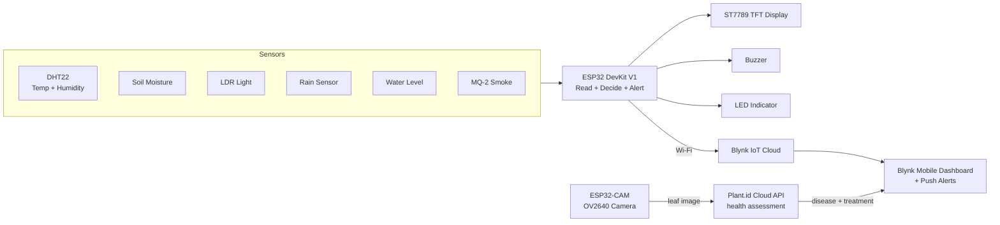

# AI-Enabled Plant Health Monitoring & Safety System

An ESP32-based smart agriculture system that continuously monitors plant and field
conditions — soil moisture, temperature, humidity, light, rainfall, water level and
smoke — shows the readings on an on-board TFT display, pushes them to a Blynk IoT
cloud dashboard, and raises local + remote alerts when anything goes out of range.
A companion **ESP32-CAM** module photographs a leaf and uses a cloud vision API
(**Plant.id**) to detect plant diseases and suggest treatment.


---

## Table of Contents

- [Overview](#overview)
- [Problem Statement](#problem-statement)
- [Key Features](#key-features)
- [System Architecture](#system-architecture)
- [Hardware Components](#hardware-components)
- [Pin Mapping](#pin-mapping)
- [How It Works](#how-it-works)
- [Alert Thresholds](#alert-thresholds)
- [Blynk Dashboard](#blynk-dashboard)
- [Plant Disease Detection (ESP32-CAM)](#plant-disease-detection-esp32-cam)
- [Getting Started](#getting-started)
- [Configuration & Secrets](#configuration--secrets)
- [Project Structure](#project-structure)
- [Demo](#demo)
- [Known Limitations & Future Scope](#known-limitations--future-scope)
- [Author](#author)
- [License](#license)

---

## Overview

Small and marginal farmers often have no easy way to know what is happening in their
field or with their stored produce until damage is already done — a crop dries out,
a tank runs empty, or smoke/fire starts in a storage area. This project is a
low-cost, connected monitoring node that watches the most important environmental
parameters and warns the user the moment something needs attention.

It combines an **ESP32** microcontroller, a set of low-cost sensors, a **local TFT
display** for on-site readouts, and the **Blynk IoT platform** for remote monitoring
and push alerts from anywhere. On top of monitoring, an **ESP32-CAM** node adds
**plant disease diagnosis**: it captures a leaf image and queries the **Plant.id**
cloud API to identify diseases and recommend treatment.

## Problem Statement

- Crop health depends on soil moisture, temperature, humidity and light — all of
  which change constantly and are invisible to the naked eye.
- Water tanks run dry and rainwater events are missed, wasting water or drowning crops.
- Fire/smoke in farm storage is a serious safety hazard with no early warning.
- Manual inspection is time-consuming and does not scale beyond a small plot.
- **Plant diseases are often only noticed after visible, irreversible damage** — early
  diagnosis needs expert knowledge that most smallholders do not have on hand.

This system automates environmental monitoring, gives the user an on-device display
and a phone dashboard with real-time alerts, and adds camera-based disease detection.

## Key Features

- **Multi-sensor monitoring** — soil moisture, temperature, humidity, light, rain,
  water level and smoke, all read continuously.
- **On-board TFT display** — live values and a colour-coded system status
  (SAFE / WARNING / DANGER) rendered on an ST7789 SPI display.
- **Cloud dashboard (Blynk)** — every reading is pushed to virtual pins and viewable
  on the Blynk mobile app in real time.
- **Plant disease detection** — a companion **ESP32-CAM** photographs a leaf and calls
  the **Plant.id** cloud API to identify likely diseases and return treatment advice.
- **Smart alerting** — threshold-based push notifications via Blynk events, plus a
  **local buzzer** for smoke and an **LED** indicator for low light.
- **Debounced alerts** — each alert fires only once per event and resets
  automatically, avoiding notification spam.
- **Wi-Fi connected** — no extra gateway needed; both boards talk to the cloud directly.

## System Architecture



The system has two nodes: the **monitoring node** (ESP32 DevKit V1 + sensors) and the
**disease-detection node** (ESP32-CAM). Both connect to Wi-Fi independently, and their
results surface in the same Blynk mobile dashboard.

## Hardware Components

| # | Component | Qty | Purpose |
|---|-----------|-----|---------|
| 1 | ESP32 DevKit V1 | 1 | Monitoring node — read, decide, alert |
| 2 | ESP32-CAM (AI-Thinker, OV2640) | 1 | Captures leaf images for disease detection |
| 3 | FTDI / USB-TTL programmer | 1 | Flashing the ESP32-CAM (no on-board USB) |
| 4 | DHT22 (AM2302) | 1 | Temperature & humidity sensing |
| 5 | Soil moisture sensor | 1 | Soil moisture / irrigation need |
| 6 | LDR (light) module | 1 | Ambient light level |
| 7 | Rain sensor module | 1 | Rainfall detection |
| 8 | Water level sensor | 1 | Tank / reservoir level |
| 9 | MQ-2 smoke & gas sensor | 1 | Smoke / fire safety |
| 10 | ST7789 TFT display (240x320, SPI) | 1 | On-device live readout |
| 11 | Active buzzer | 1 | Audible smoke alarm |
| 12 | LED | 1 | Low-light indicator |
| 13 | Breadboard + jumper wires | — | Prototyping connections |
| 14 | 5V supply / USB | 1 | Power |

## Pin Mapping

### Monitoring node (ESP32 DevKit V1)

| Function | ESP32 GPIO | Notes |
|----------|-----------|-------|
| TFT CS | 5 | ST7789 chip select |
| TFT DC | 2 | Data / command |
| TFT RST | 15 | Reset |
| DHT22 data | 4 | Temp + humidity |
| Soil moisture | 34 | ADC input |
| LDR / light | 35 | ADC input |
| Rain sensor | 32 | ADC input |
| Water level | 33 | ADC input |
| Smoke (MQ-2) | 39 | ADC input (VN) |
| Buzzer | 27 | Digital output |
| LED | 26 | Digital output |

> **Note:** All analog sensors are wired to **ADC1** pins (32–39). This is deliberate —
> ADC2 pins on the ESP32 conflict with Wi-Fi, so using ADC1 keeps the analog readings
> stable while the device is connected.

### Disease-detection node (ESP32-CAM, AI-Thinker)

The camera uses fixed internal pins — no external wiring is required:

| Signal | GPIO | Signal | GPIO |
|--------|------|--------|------|
| XCLK | 0 | Y2 | 5 |
| SIOD | 26 | Y3 | 18 |
| SIOC | 27 | Y4 | 19 |
| Y9 | 35 | Y5 | 21 |
| Y8 | 34 | Y6 | 36 |
| Y7 | 39 | HREF | 23 |
| VSYNC | 25 | PCLK | 22 |
| PWDN | 32 | RESET | -1 |

> The ESP32-CAM has no USB port — program it with an FTDI adapter (GPIO0 to GND while
> flashing). Enable **PSRAM** in the board settings; the JPEG buffer needs it.

## How It Works

### Monitoring node

1. **Setup** — the ESP32 initialises the DHT22, configures the buzzer and LED, shows a
   splash screen on the TFT, then connects to Wi-Fi and the Blynk cloud.
2. **Read** — every loop cycle, `readSensors()` samples all seven inputs and derives a
   human-readable status for each (WET/DRY, BRIGHT/DARK, RAIN/NO RAIN, LOW/HIGH,
   SAFE/DETECTED).
3. **Display** — `displayData()` refreshes the TFT with the latest values and a
   colour-coded overall system status (green = SAFE, yellow = WARNING, red = DANGER).
4. **Report** — `sendToBlynk()` (every 2 s via a `BlynkTimer`) pushes all values to
   virtual pins V0–V7 on the Blynk dashboard.
5. **Alert** — if any value crosses its threshold, a Blynk event notification is fired
   once (guarded by an alert flag) and, for smoke, the local buzzer sounds.

The main loop runs continuously with a 2-second cadence.

### Disease-detection node

See [Plant Disease Detection (ESP32-CAM)](#plant-disease-detection-esp32-cam).

## Alert Thresholds

| Parameter | Condition | Status / Action |
|-----------|-----------|-----------------|
| Temperature | > 35 °C | WARNING + Blynk alert |
| Humidity | > 80 % | WARNING + Blynk alert |
| Soil moisture | < 1800 (ADC) | WARNING + "Soil is Dry" alert |
| Rain | < 1500 (ADC) | WARNING + "Rain Detected" alert |
| Water level | < 1500 (ADC) | WARNING + "Water Tank Low" alert |
| Smoke | > 500 (ADC) | DANGER + buzzer + "Smoke Detected" alert |
| Light | > 2000 (ADC) | DARK — LED turns on |

> Threshold values are `#define`s near the top of the sketch and can be tuned for your
> own sensor calibration and field conditions.

## Blynk Dashboard

| Virtual Pin | Data |
|-------------|------|
| V0 | Temperature (°C) |
| V1 | Humidity (%) |
| V2 | Soil moisture (raw) |
| V3 | Light (raw) |
| V4 | Rain (raw) |
| V5 | Water level (raw) |
| V6 | Smoke (raw) |
| V7 | System status string |

Blynk events configured: `temperature`, `humidity`, `soil`, `rain`, `water`, `smoke`.

A suggested addition for the disease module: **V8 = last detected disease** and
**V9 = confidence**, so a diagnosis also appears on the same dashboard.

## Plant Disease Detection (ESP32-CAM)

### Why this module

The sensors above tell you the *conditions* a plant is living in — they cannot tell you
the plant is *sick*. This module adds a camera node that looks at a leaf and asks a
cloud vision model what is wrong with it, returning a likely disease and its treatment.

### How it works

1. The **ESP32-CAM** captures a JPEG of a single leaf with its OV2640 camera.
2. The image is Base64-encoded and sent in an HTTPS `POST` to the **Plant.id** health
   assessment endpoint, authenticated with your API key.
3. The API returns JSON containing whether the plant looks healthy, and a ranked list of
   disease suggestions — each with a name, a confidence probability, and (if requested)
   a description and treatment advice.
4. The firmware reads the top suggestion and reports it over Serial, and optionally
   pushes it to the Blynk dashboard (V8/V9).

### API call

```
POST https://api.plant.id/v3/health_assessment?details=description,treatment
Headers:
    Api-Key: <PLANTID_API_KEY>
    Content-Type: application/json
Body:
    {"images": ["<base64-encoded JPEG>"]}
```

Abridged response:

```json
{
  "result": {
    "is_healthy": { "binary": false, "probability": 0.05 },
    "disease": {
      "suggestions": [
        {
          "name": "Powdery mildew",
          "probability": 0.87,
          "details": {
            "description": "Fungal disease ...",
            "treatment": "Apply a fungicide ..."
          }
        }
      ]
    }
  }
}
```

Notes:
- Plant.id (by Kindwise) also accepts `multipart/form-data`; the Base64 JSON form is
  the simplest to build from a microcontroller.
- Each health assessment consumes API credits — check the current free tier and
  pricing on your Kindwise account.
- Keep the API key in `secrets.h`, never in the sketch (see
  [Configuration & Secrets](#configuration--secrets)).

### ESP32-CAM firmware (illustrative)

The full sketch lives in `esp32cam_disease.ino`. The core of it:

```cpp
#include "esp_camera.h"
#include "secrets.h"                 // WIFI_SSID, WIFI_PASSWORD, PLANTID_API_KEY
#include <WiFiClientSecure.h>
#include <HTTPClient.h>
#include <base64.h>

// AI-Thinker ESP32-CAM camera pin map
#define PWDN_GPIO_NUM  32
#define RESET_GPIO_NUM -1
#define XCLK_GPIO_NUM   0
#define SIOD_GPIO_NUM  26
#define SIOC_GPIO_NUM  27
#define Y9_GPIO_NUM    35
#define Y8_GPIO_NUM    34
#define Y7_GPIO_NUM    39
#define Y6_GPIO_NUM    36
#define Y5_GPIO_NUM    21
#define Y4_GPIO_NUM    19
#define Y3_GPIO_NUM    18
#define Y2_GPIO_NUM     5
#define VSYNC_GPIO_NUM 25
#define HREF_GPIO_NUM  23
#define PCLK_GPIO_NUM  22

void startCamera() {
  camera_config_t c = {};
  c.ledc_channel = LEDC_CHANNEL_0;
  c.ledc_timer   = LEDC_TIMER_0;
  c.pin_pwdn = PWDN_GPIO_NUM;  c.pin_reset = RESET_GPIO_NUM;
  c.pin_xclk = XCLK_GPIO_NUM;  c.pin_sccb_sda = SIOD_GPIO_NUM;
  c.pin_sccb_scl = SIOC_GPIO_NUM;
  c.pin_d7 = Y9_GPIO_NUM; c.pin_d6 = Y8_GPIO_NUM; c.pin_d5 = Y7_GPIO_NUM;
  c.pin_d4 = Y6_GPIO_NUM; c.pin_d3 = Y5_GPIO_NUM; c.pin_d2 = Y4_GPIO_NUM;
  c.pin_d1 = Y3_GPIO_NUM; c.pin_d0 = Y2_GPIO_NUM;
  c.pin_vsync = VSYNC_GPIO_NUM; c.pin_href = HREF_GPIO_NUM; c.pin_pclk = PCLK_GPIO_NUM;
  c.xclk_freq_hz = 20000000;
  c.pixel_format = PIXFORMAT_JPEG;
  c.frame_size   = FRAMESIZE_VGA;   // 640x480 is plenty for a leaf
  c.jpeg_quality = 12;
  c.fb_count     = 1;
  esp_camera_init(&c);
}

void diagnoseLeaf() {
  camera_fb_t *fb = esp_camera_fb_get();
  if (!fb) return;

  String b64 = base64::encode(fb->buf, fb->len);
  esp_camera_fb_return(fb);

  WiFiClientSecure client;
  client.setInsecure();             // demo only — pin the CA cert in production
  HTTPClient https;
  https.begin(client, "https://api.plant.id/v3/health_assessment?details=description,treatment");
  https.addHeader("Content-Type", "application/json");
  https.addHeader("Api-Key", PLANTID_API_KEY);

  String body = "{\"images\":[\"" + b64 + "\"]}";
  int code = https.POST(body);
  if (code == 200) Serial.println(https.getString());   // parse the JSON result
  https.end();
}
```

> The sketch above is illustrative. A production version should verify the TLS
> certificate, parse the JSON with `ArduinoJson`, and add retry/timeout handling.

## Getting Started

### Prerequisites

- [Arduino IDE](https://www.arduino.cc/en/software) (or PlatformIO)
- ESP32 board support installed in the Arduino IDE (choose **AI Thinker ESP32-CAM** for
  the camera board, with PSRAM enabled)
- A free [Blynk](https://blynk.io/) account and a template with the datastreams above
- A free [Plant.id / Kindwise](https://www.kindwise.com/plant-id) account and API key

### Required Libraries

Install these from the Arduino Library Manager:

- `Blynk` (BlynkSimpleEsp32)
- `DHT sensor library` (Adafruit) + `Adafruit Unified Sensor`
- `Adafruit GFX Library`
- `Adafruit ST7735 and ST7789 Library`
- `ArduinoJson`
- `base64` (or the built-in `mbedtls` Base64 helpers)

### Steps

1. Clone or download this repository.
2. Copy `secrets.h.example` to `secrets.h` and fill in your own Wi-Fi, Blynk and
   Plant.id credentials (see below). **Do not commit `secrets.h`.**
3. **Monitoring node:** open the main sketch, select **ESP32 Dev Module** as the board
   and the correct COM port, wire the sensors as per the pin table, and upload.
4. **Disease-detection node:** wire the FTDI adapter to the ESP32-CAM (GPIO0 to GND),
   open `esp32cam_disease.ino`, select **AI Thinker ESP32-CAM**, enable PSRAM, and
   upload. Remove the GPIO0-GND link and reset.
5. The TFT shows live readings, the Blynk app updates within seconds, and pointing the
   camera at a leaf and triggering a capture prints the diagnosis over Serial.

## Configuration & Secrets

Credentials are kept **out of the source code** via a `secrets.h` file:

```cpp
// secrets.h  (git-ignored — never commit this file)
#define WIFI_SSID           "your-wifi-name"
#define WIFI_PASSWORD       "your-wifi-password"
#define BLYNK_TEMPLATE_ID   "TMPLxxxxxxxx"
#define BLYNK_TEMPLATE_NAME "Your Template Name"
#define BLYNK_AUTH_TOKEN    "your-blynk-auth-token"
#define PLANTID_API_KEY     "your-plant-id-api-key"
```

In the sketches, include it and use the macros:

```cpp
#include "secrets.h"

char ssid[] = WIFI_SSID;
char pass[] = WIFI_PASSWORD;
```

A ready-to-use template is provided as `secrets.h.example`. Add `secrets.h` to
`.gitignore` so your real credentials never reach GitHub.

## Project Structure

```
AI-Enabled-Plant-Health-Monitoring-And-Safety/
├── project1.ino.ino          # Main ESP32 monitoring firmware
├── esp32cam_disease.ino      # ESP32-CAM leaf disease detection firmware (to be added)
├── secrets.h.example         # Credential template (copy to secrets.h)
├── .gitignore                # Keeps secrets.h out of the repo
├── LICENSE                   # MIT
└── README.md                 # This file
```

## Demo

_Add photos or a short screen recording here — judges respond well to a visual._

Suggested images to add:

- `docs/setup.jpg` — the assembled hardware / breadboard
- `docs/tft-display.jpg` — the TFT showing live readings
- `docs/blynk-app.png` — the Blynk dashboard on a phone
- `docs/disease-result.png` — a leaf photo next to its detected disease
- `docs/circuit.png` — a wiring / circuit diagram

## Known Limitations & Future Scope

**Current limitations**

- Readings are raw ADC values; they are not yet converted to calibrated units
  (e.g. % soil moisture, litres of water).
- Sensor logic and thresholds are fixed in firmware; there is no on-the-fly tuning.
- Alerts go to Blynk only — no SMS/e-mail fallback if the device is offline.
- Disease detection needs an internet connection and a cloud API key; it cannot work
  fully offline.

**Future scope**

- Add automatic irrigation control (relay + water pump) driven by soil moisture.
- Calibrate sensors and report values in real units.
- Add OTA firmware updates and offline data logging to SD card.
- On-device (TinyML) disease inference as an offline fallback to the cloud API.
- Automatic periodic leaf scanning and a history of diagnoses per plant.
- Solar power + weatherproof enclosure for field deployment.

## Author

**Ankit Tiwari**
GitHub: [@allrounderankit](https://github.com/allrounderankit)

## License

This project is licensed under the MIT License — see the [LICENSE](LICENSE) file.
